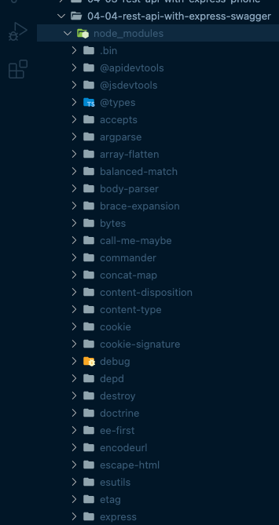
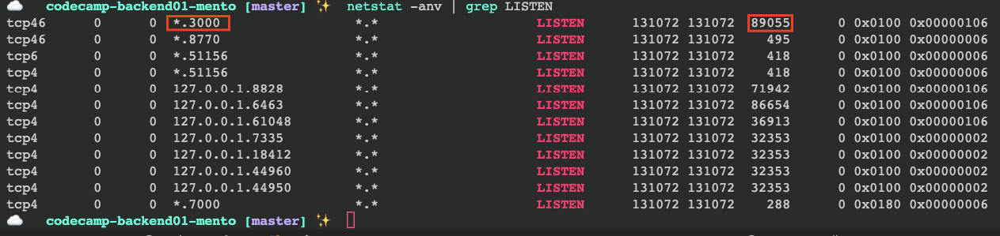
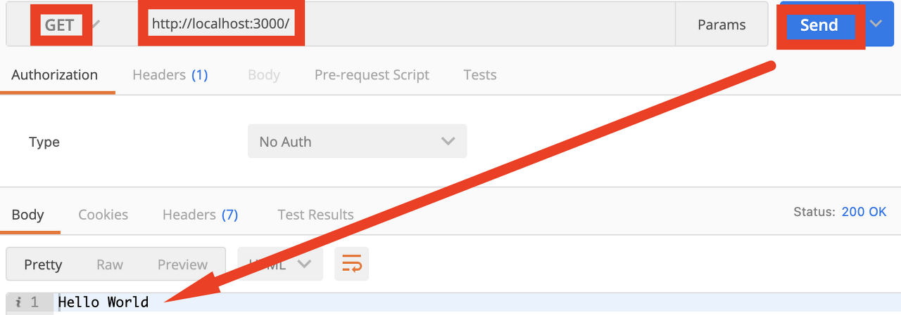
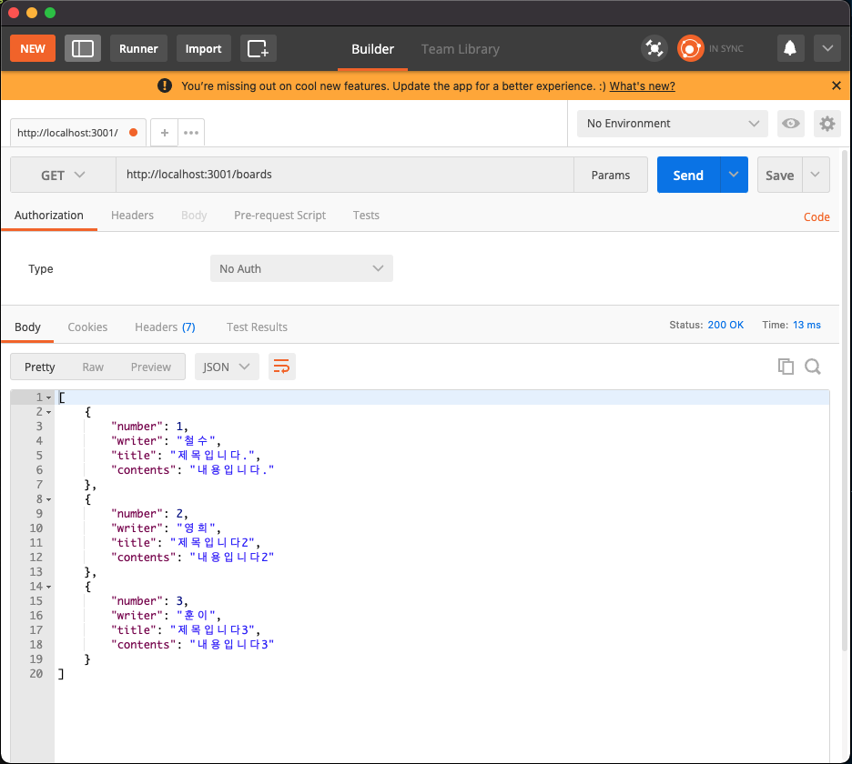
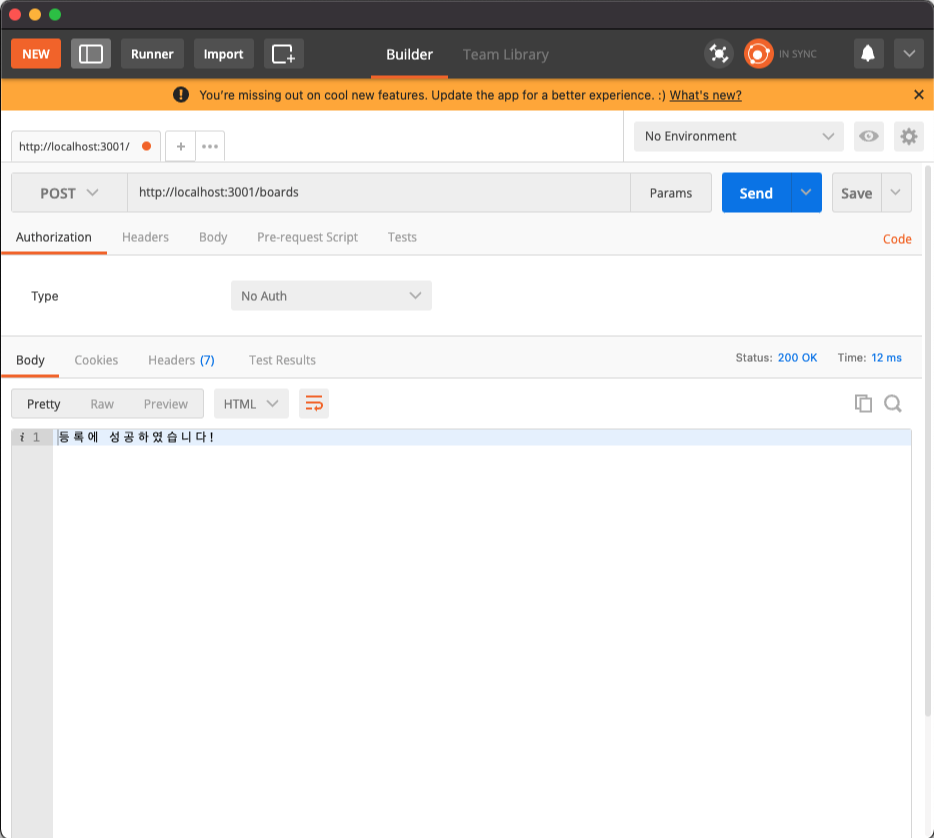
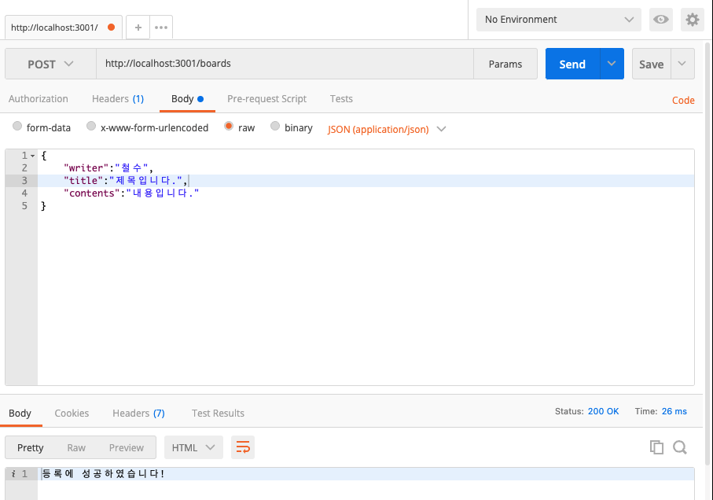
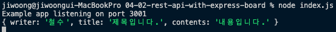

## 4일차 Today-I-Learned


*REST-API*

## 반복문

> 💡일정 로직을 계속 반복해서 실행하는 문법

### for

```javascript
for(최초식;조건식;증감식) { ~~~ }
```

최초식 - 반복문을 처음 실행할 때 선언(어디서부터 시작하는지를 결정하는 시작점)  
조건식 - 반복문을 실행하는 조건을 설정(해당 조건식이 true일 때만 로직을 실행)  
증감식 - 반복문을 실행할 때마다 최초식을 증감(반복문의 실행 횟수를 조절할 수 있다)

#### break

원하는 구간에서 반복문을 종료

```javascript
for(let i=0; i<5; i=i+1) {
  if(i===2) {
    break;
  }
  console.log(i) //0, 1
}
```

#### continue

해당 구간의 반복문을 실행하지 않음(뛰어넘음)

```javascript
for(let i=0; i<5; i=i+1) {
  if(i===2) {
    continue;
  }
  console.log(i) //0, 1, 3, 4
}
```

### for-in

객체를 반복할 수 있다. (문자열, 객체, 배열)

```javascript
obj = {
  name: "철수",
  age: 12
}

for(let key in obj) {
  console.log(obj[key]) //'철수', 12
}
```

### for-of

각각의 요소들을 가져올 수 있다. (문자열, 배열)

다른 반복문보다 느려서 효율성 측면에서 좋지 않다.

```javascript
str = "abc"

for(let data of str) {
  console.log(data) //'a', 'b', 'c'
}
```

### for-each

배열에만 사용할 수 있다.

```javascript
//Array.forEach(function()) //표기법

const arr = ['a','b','c']

arr.forEach( function(el) {
  console.log(el) //'a', 'b', 'c'
} )

arr.forEach(el => {
  console.log(el) //'a', 'b', 'c'
})
```

### while

최초식, 조건식, 증감식이 분할되어 있다.

```javascript
let count = 0; //최초식
while( count !== 5 ) { //조건식
  console.log(count) //0, 1, 2, 3, 4
  count++; //증감식
}
```

## express 설치

> 💡express는 Node에서 쉽게 웹 서버를 개발할 수 있도록 도와주는 프레임워크다  
> (공식 홈페이지: https://expressjs.com/ko/)

express 설치는 아래와 같이하면 된다.

```shell
yarn init

yarn add express #express 설치
```



*yarn add express 입력 시 위와 같이 설치된다*

node\_modules 디렉토리에 express가 설치되고, package.json 파일에 dependencies 속성 목록에 express가 추가된다.

```javascript
{
  "name": "04-01-rest-api-with-express",
  "version": "1.0.0",
  "main": "index.js",
  "license": "MIT",
  "dependencies": {
    "express": "^4.17.3",
    "swagger-jsdoc": "^6.1.0",
    "swagger-ui-express": "^4.3.0"
  },
  "type": "module"
}
```

package.json 파일의 dependencies에 express가 추가된 모습

node\_modules 디렉토리를 삭제하더라도, yarn install을 하면 package.json을 참고하여 dependencies에 있는 것들을 설치할 수 있다.  
yarn.lock 파일도 설치한 패키지의 버전관리를 하는 파일인데, 설치하는 패키지가 참고하는 다른 라이브러리들의 버전들도 함께 관리하는 역할을 한다. 따라서 github에 업로드 시, yarn.lock 파일도 같이 올려야 한다.

## REST-API 만들기

```javascript
const express = require("express");
const app = express();

app.get("/", (req, res) => {
  res.send("Hello World!");
});

app.listen(3000, () => {
  console.log(`Example app listening on port ${3000}`);
});
```

express를 사용하려면 js파일에 express를 불러와야 한다.

```javascript
const express = require("express"); //commonJS 방식

or

import express from "express"; //module 방식
```

commonJS 방식 혹은 module 방식을 선택해서 불러오면 된다. module 방식을 사용할 경우, package.json 파일에 “type”: “module” 을 추가해줘야 한다.

불러온 express를 실행해, 그 결과를 새로운 변수 app 에 담아준다. 그리고 GET 요청이 왔을 경우, 뒤의 핸들러 함수를 통해 Hello World라고 응답을 보내준다.

req는 Request의 줄임말로, 브라우저에서 보낸 HTTP 요청이 들어있다.

(브라우저 주소, 쿠키, 바디, 쿼리 등)

res는 Response의 줄임말로, 서버에서 다시 클라이언트(브라우저)로의 응답 내용을 담는 변수다.

(쿠키, HTTP status, json 등)

서버에서 요청을 수신할 수 있어야 하므로, 3000번 포트로 listen하고 콜백함수를 통해 3000번 포트로 대기중인 것을 콘솔로 출력해준다. (서버라는 것은 다른 사람들의 요청을 받을 수 있도록 이처럼 24시간 돌아가는 컴퓨터를 말한다.)

(port 번호는 0 ~ 65535 숫자 내에서 할당이 가능하고, 한 컴퓨터에서 동시에 동일한 port를 사용할 수 없다.)

만약 address already in use :::3000 과 같은 에러가 발생한다면, 동일한 port를 사용중인 프로그램이 있는 것이므로, netstat -anv | grep LISTEN 명령어를 통해 해당 port를 사용중인 process ID를 찾아야 한다.



kill -9 프로세스\_아이디 로 해당 process를 종료해주면 된다. (ex. kill -9 89055)



postman을 이용해 http://localhost:3000/ 에 GET 요청을 보내면, 위와 같은 응답을 받을 수 있다.

웹 구축을 위한 각 서버를 한눈에 보자면,

**프론트엔드 서버**

프론트엔드 서버프로그램(사용자의 요청을 기다림)

**백엔드 서버(API 서버)**

백엔드 서버프로그램(프론트의 요청을 기다림)

**데이터베이스 서버(DB 서버)**

데이터베이스 서버프로그램(백엔드의 요청을 기다림)

위 3개 서버는 24시간 켜져있으며 요청을 listen하고 있음

### 라우팅

> 💡라우팅은 URI(또는 경로) 및 특정한 HTTP 요청 메소드(GET, POST 등)인 특정 엔드포인트에 대한 클라이언트 요청에 애플리케이션이 응답하는 방법을 결정하는 것을 말한다.

각 라우트는 하나 이상의 핸들러 함수를 가질 수 있으며, 이러한 함수는 라우트가 일치할 때 실행된다.

app.METHOD(PATH, HANDLER) 와 같은 형태로 예제는 아래와 같다.

```javascript
app.get('/', function (req, res) {
  res.send('Hello World!');
});
```

### RESTful

path명을 동일하게 가져가서, CRUD를 더 깔끔하게 정리(method로 구분 가능)

이해하기 쉽고 사용하기 쉽도록 일관적인 API 작성

```javascript
app.get("/boards/:id", (req, res) => {
  console.log(req);
  res.send("Hello World!");
});

app.get("/boards", (req, res) => {
  console.log(req);
  res.send("Hello World!");
});

app.post("/boards", (req, res) => {
  console.log(req);
  res.send("Hello World!");
});

app.put("/boards/:id", (req, res) => {
  console.log(req);
  res.send("Hello World!");
});

app.delete("/boards/:id", (req, res) => {
  console.log(req);
  res.send("Hello World!");
});
```

### API 테스트

```javascript
const express = require("express");
const app = express();

app.get("/boards", (req, res) => {
  // 1. 데이터를 조회하는 로직 => DB에 접속해서 데이터 꺼내오기
  const result = [
    {
      number: 1,
      writer: "철수",
      title: "제목입니다.",
      contents: "내용입니다.",
    },
    {
      number: 2,
      writer: "영희",
      title: "제목입니다2",
      contents: "내용입니다2",
    },
    {
      number: 3,
      writer: "훈이",
      title: "제목입니다3",
      contents: "내용입니다3",
    },
  ];

  // 2. 꺼내온 결과 응답 주기
  res.send(result);
});

app.post("/boards", (req, res) => {
  // 1. 데이터를 등록하는 로직 => DB에 접속해서 데이터 저장하기

  // 2. 저장 결과 알려주기
  res.send("등록에 성공하였습니다!");
});

// app.get("/boards/:id", (req, res) => {
//   console.log(req);
//   res.send("Hello World!");
// });

// app.put("/boards/:id", (req, res) => {
//   console.log(req);
//   res.send("Hello World!");
// });

// app.delete("/boards/:id", (req, res) => {
//   console.log(req);
//   res.send("Hello World!");
// });

app.listen(3001, () => {
  console.log(`Example app listening on port ${3001}`);
});
```

위의 코드는 객체의 배열을 선언해서 API에서 브라우저로 전달해주고 있다.





POST로 요청이 들어오면, 등록에 성공하였다는 결과를 준다.

```javascript
const express = require("express");
const app = express();

app.use(express.json()); //JSON.parse()와 같음

app.post("/boards", (req, res) => {
  // 1. 데이터를 등록하는 로직 => DB에 접속해서 데이터 저장하기
  // 프론트엔드로부터 데이터 받아오기
  // 콘솔로 찍어서 확인해보기
  console.log(req.body);

  // 2. 저장 결과 알려주기
  res.send("등록에 성공하였습니다!");
});
```

위 코드에서는 브라우저로부터 JSON 형식의 데이터를 전달해주지만, express가 문자열이 아닌 객체를 읽을 수 있기 때문에, app.use(express.json())을 통해 문자열을 객체로 변환해야 한다.(JSON.parse()와 같은 역할)





postman에서 JSON 형식으로 객체를 POST로 요청하면, 아래 콘솔에 데이터를 잘 출력해주고 있는 것을 확인할 수 있다.

### require & import 방식

패키지나 다른 js파일을 import할 때, commonJS 방식과 module 방식이 있다.

express의 경우에는 commonJS 모듈이기에,

```javascript
//1.
import { express } from "express"; //작동하지 않음

//2.
import express from "express"; //작동함
```

첫번째 문법은 지원하지 않고, 두번째 문법으로 작성해야 한다.

> ❗️commonJS 방식으로 const { ~~~, ~~~, ~~~ } = require("./phone.js"); 와 같은 문법을 제공하지 않는지?  
> (commonJS는 이전 방식으로, const ~~~ = require(”./phone.js”);으로 사용해야 하는 것으로 알고 있음)

또한, import, export 시

```javascript
//1.
export default {
	~~~
}

import ~~~ from ~~~;

//2.
export const ~~~ {
	~~~
}

import { ~~~1, ~~~2 } from ~~~
```

1번과 같이 default로 export 선언된 경우, import시 소괄호 없이 사용해야 하고,  
2번과 같이 const로 여러개 export된 경우, import시 소괄호로 묶어서 사용할 수 있다.

## Swagger

> 💡Swagger는 REST-API를 쉽게 문서화하고 테스트할 수 있도록 도와주는 도구이다.

API를 swagger와 연결하기 위해서는, 설치해야 할 npm 모듈이 2가지이다.

-   swagger-ui-express
-   swagger-jsdoc

### swagger-ui-express

API 설명이 적힌 파일을 넘겨주면, express에서 swagger UI를 띄워준다.

```shell
npm install swagger-ui-express

or

yarn add swagger-ui-express
```

### swagger-jsdoc

주석으로 API에 대한 설명을 적으면, swagger-ui-express에 넘겨줄 문서를 만들 수 있다.

```shell
npm install swagger-jsdoc

or

yarn add swagger-jsdoc
```

swagger-jsdoc에서 주석으로 API 설명 작성 후, swagger-ui-express에 넘겨주면 UI에서 해당 설명을 띄워주는 방식이다.

보통 swagger 디렉토리를 별도로 생성하여, ~~~.swagger.js 와 같은 파일명으로 작성한다.

```javascript
/**
 * @swagger
 * /boards:
 *      get:
 *          summary: 게시글 가져오기
 *          tags: [Board]
 *          parameters:
 *              - in: query
 *                name: number
 *                type: int
 *          responses:
 *              200:
 *                  description: 성공
 *                  content:
 *                      application/json:
 *                          schema:
 *                            type: array
 *                            items:
 *                              type: object
 *                              properties:
 *                                  number:
 *	                                    type: int
 *	                                    example: 1
 *                                  writer:
 *	                                    type: string
 *	                                    example: 철수
 *                                  title:
 *	                                    type: string
 *	                                    example: 제목입니다~~~
 *                                  contents:
 *	                                    type: string
 *	                                    example: 내용이에요!!!
 */

/**
 * @swagger
 * /boards:
 *       post:
 *          summary: 게시글 등록하기
 *          tags: [Board]
 *          parameters:
 *              - in: query
 *                name: writer
 *                type: string
 *              - in: query
 *                name: password
 *                type: string
 *              - in: query
 *                name: title
 *                type: string
 *              - in: query
 *                name: contents
 *                type: string
 *          responses:
 *              200:
 *                  description: 성공
 *                  content:
 *                      application/json:
 *                          schema:
 *                              type: object
 *                              properties:
 *                                  message:
 *	                                    type: string
 *	                                    example: 게시물이 정상적으로 등록되었습니다.
 */
```

Swagger 파일 예시로, 주석으로 작성하며 들여쓰기에 따라 작동하므로 주의해서 작성한다.

http://localhost:3000/api-docs/에 접속하면 설정한 swagger 문서를 확인할 수 있다.
