## 5일차 Today-I-Learned

## Axios

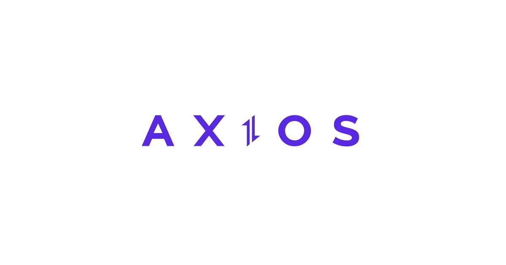

*Axios*

> 💡브라우저, Node.js를 위한 Promise API를 활용하는 HTTP 비동기 통신 라이브러리

프론트엔드 - 백엔드 간의 통신을 위해 사용하는 통신 라이브러리이다.

지난번에 작성한 백엔드의 API에 접근하는 프론트엔드의 관점에서 테스트를 해보려고 한다.

아래와 같은 간단한 HTML을 작성했다.

휴대폰번호를 입력하고 인증하기 버튼을 누르면 백엔드에서 인증번호를 생성하고, 프론트엔드에서는 인증상태가 인증완료로 변경된다.

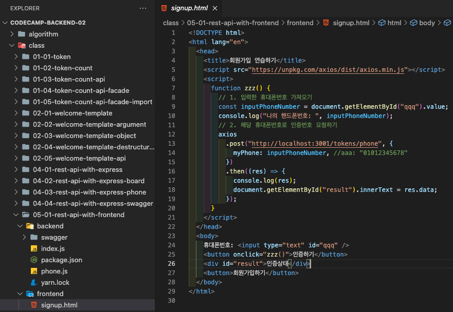

*예시로 작성한 프론트엔드 소스*

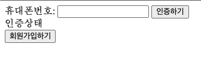

*휴대폰번호 입력 및 인증하기 버튼 클릭시 인증상태 변경*

npmjs.com에 들어가서 보면 axios를 사용하는 방법에는 여러가지가 있는데,

HTML 파일에서는 axios를 import 해줄수 없다.

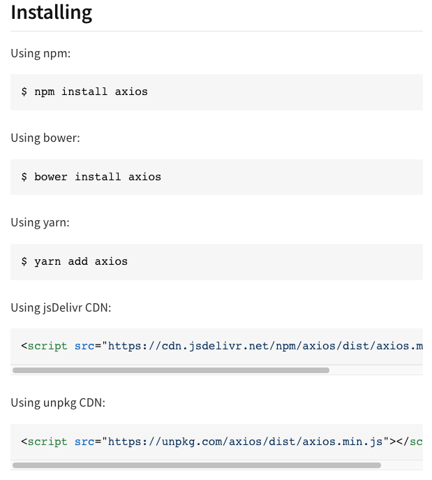

*axios 설치 방법*

그래서 이중 가장 마지막에 있는 unpkg CDN 방법을 이용해 script를 추가해주었다.

jsDelivr CDN, unpkg CDN에 대한 자세한 내용은 추후 공부하여 다루도록 하겠다.

axios script를 삽입하면, window 안에 axios라는 변수가 만들어진다.

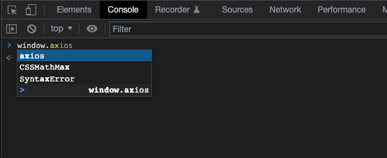

*콘솔에서 확인시 window 아래에 axios 변수가 생성됨*

window.axios 혹은 axios로 접근이 가능하다.

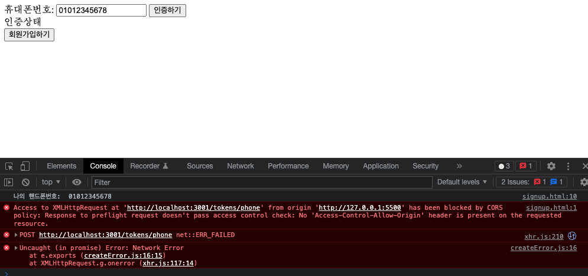

그런데, 백엔드 서버를 실행 후, 프론트엔드에서 인증하기를 클릭하면 위와 같이 에러가 발생한다.

Postman이나 모바일 앱에서는 POST가 정상적으로 되지만,

작성한 소스로는 CORS Policy 에러가 발생하는 것을 확인할 수 있다.

### CORS(Cross Origin Resource Sharing)

Origin과 다른 사이트에서의 요청에 대한 응답을 설정해주는 옵션

기본적으로, 요청하는 Origin과 타겟이 다르면 브라우저에서 백엔드의 응답을 차단한다.

(위에서는 127.0.0.1:5000 -> localhost:3001이 차단됐다)

CORS 옵션은 백엔드에서 설정이 가능하다.

허용해주려면 마찬가지로 백엔드에서 CORS 패키지 설치가 필요하다.

```javascript
npm install cors

혹은

yarn add cors
```

```javascript
import cors from "cors";

app.use(cors()); //모든 CORS 허용
```

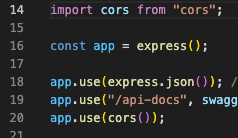

import 및 app.use(cors());를 통해 모든 요청을 허용해줄 수 있다. 특정 서버에서의 요청만 허용하는 옵션도 있다.

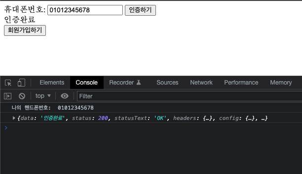

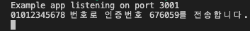

소스를 수정 후 다시 실행하고 테스트해보면, 위와 같이 정상적으로 작동하는 것을 확인할 수 있다.

## Nodemon

지금까지 백엔드 쪽의 소스를 수정하면, 매번 서버를 중지하고 다시 실행시켜 주었다.

하지만 nodemon이라는 패키지를 설치해주면 백엔드 소스를 수정 및 저장할 때마다 자동으로 서버를 재시작해줄 수 있다.

```javascript
npm install nodemon

혹은

yarn add nodemon
```

node는 홈페이지에서 설치파일을 받아 컴퓨터 전체에 설치했기 때문에 node ~~~ 명령어가 유효하다.

하지만 nodemon은 위와 같이 특정 디렉토리에만 설치했기 때문에 nodemon을 실행하려면 package.json에 스크립트를 추가해줘야 한다.

```javascript
"scripts": {
    "dev": "nodemon index.js"
  },
```

위와 같이 script를 설정해주면, 터미널에서 npm run dev 혹은 yarn dev 명령어를 입력할 때 nodemon index.js가 실행된다.

별도의 script 설정 없이 nodemon을 실행하고 싶다면, 컴퓨터 전체에 nodemon을 설치해주면 된다.

```javascript
npm install -g nodemon

혹은

yarn global add nodemon
```

그러면 터미널에서 nodemon index.js와 같이 명령어 실행이 가능하다.

## GraphQL

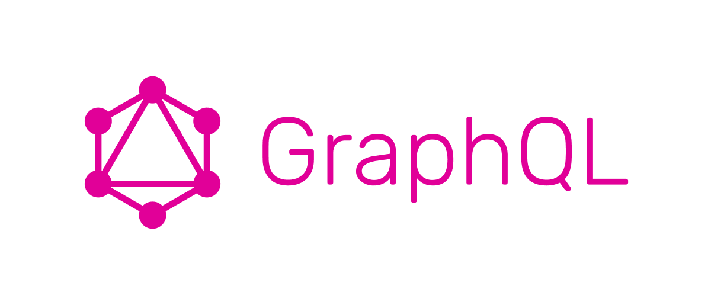

*GraphQL*

> 💡GraphQL은 API를 만들 때 사용할 수 있는 쿼리언어이다.

앞선 게시물에서 REST-API와 GraphQL-API를 비교했었는데, API 개발방법 중 하나이다.

쿼리언어로, 데이터베이스에서 쓰이는 SQL과 비교를 해보자면,

SQL - DB 시스템에 저장된 데이터를 효율적으로 가져오는 것이 목적(주로 백엔드에서 작성하고 호출)

GQL - 웹 클라이언트가 서버로부터 데이터를 효율적으로 가져오는 것이 목적(주로 클라이언트에서 작성하고 호출)

이 GraphQL을 사용할 수 있는 서버는 apollo-server 외에 여러가지가 있지만, 쉽게 사용할 수 있게 하는 서버 중 하나이다.

먼저 apollo-server와 graphql을 설치한다.

```javascript
npm install apollo-server graphql

혹은

yarn add apollo-server graphql
```

apollo-server는 단독으로 설치하는게 아니라, graphql과 같이 설치해야 한다.

설치 후에 아래와 같이 apollo-server와 graphql을 import한다.

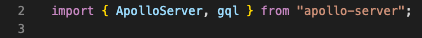

*import*

소스 예제를 보면 아래와 같이 크게 4부분으로 나뉜다.

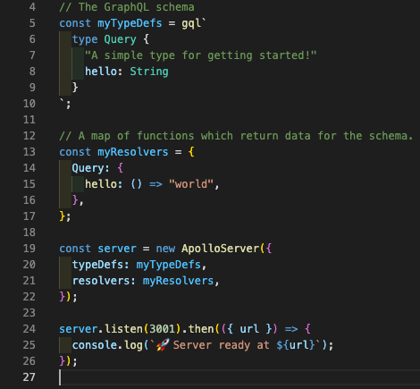

*graphQL*

-   typeDefs - GraphQL 명세에서 사용될 데이터와 타입을 지정하고 template literal tag로 생성됨
-   resolvers - 서비스의 액션들을 함수로 지정하고 요청에 따라 데이터를 반환, 입력, 수정, 삭제한다.
-   server - 위의 typeDefs와 resolvers를 인자로 받아 서버를 생성한다.
-   listen - 포트를 지정해 서버를 실행하고 리슨한다.

### typeDefs & resolvers

REST-API와 다르게 GraphQL에는 2가지 요청이 있다.

Query - 데이터베이스에서 데이터를 읽는 요청

Mutation - 데이터베이스를 등록, 수정, 삭제하는 요청

resolvers 안에 위와 같은 Query, Mutation 객체를 생성할 수 있다.

express와 다르게 GraphQL에는 한가지 더 설정하는 부분이 있는데 바로 데이터 타입을 설정해주는 부분이다.

typeDefs 안에는 type Query 객체를 선언해 반환될 데이터를 지정해준다.

resolvers와 typedefs의 type이 맞지 않으면 에러가 발생한다.

한가지 장점은 위와 같이 작성하면 express와 같이 swagger를 작성할 필요없이 playground에 문서가 생성된다는 점이다.

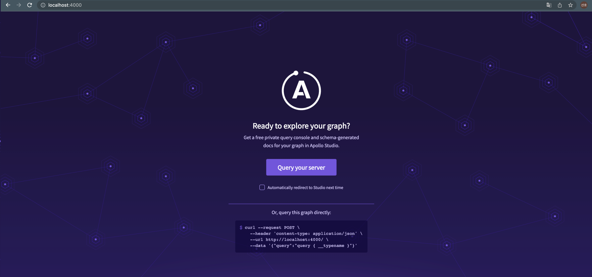

서버를 실행하고 접속하면 위와 같은 화면을 볼 수 있다.

Query your server를 클릭해 playground에 들어가 작성한 API를 테스트해 볼 수 있다.

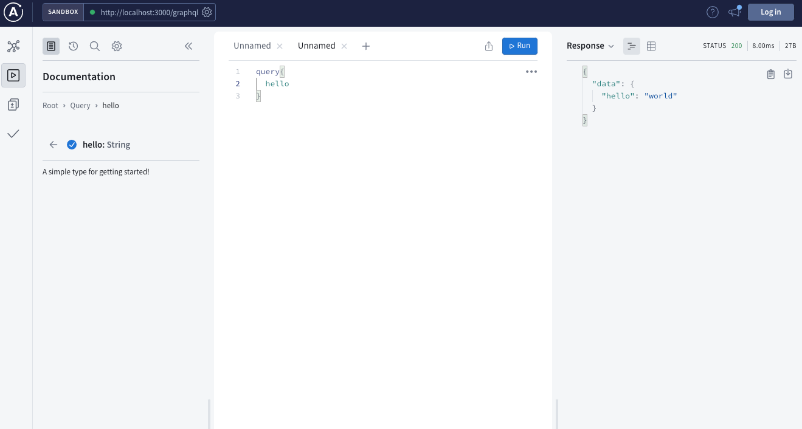

resolver에는 4개의 매개변수가 있는데 다음과 같다.

-   parent - 부모 타입 리졸버에서 반환된 결과를 가진 객체
-   args - 쿼리 요청 시 전달된 파라미터를 가진 객체
-   context - GraphQL의 모든 리졸버가 공유하는 객체로 로그인 인증, 데이터베이스 접근 권한 등에 사용
-   info - 명령 실행 상태정보를 가진 객체

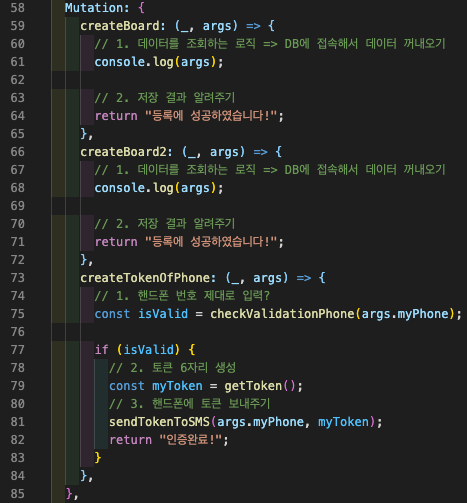

REST-API에서는 요청 데이터를 확인하기 위해 Parameter(매개변수) req를 사용했다.

GraphQL-API에서는 Parameter args를 이용해 요청된 데이터를 확인할 수 있다. 만약 해당 매개변수를 사용하지 않을 때는 \_(언더바)로 사용한다.

> ❗️매개변수의 순서가 정해져있으므로, 정의할 때 무조건 순서를 지켜야 하며, 사용하지 않는 매개변수는 \_(언더바)로 표기한다.

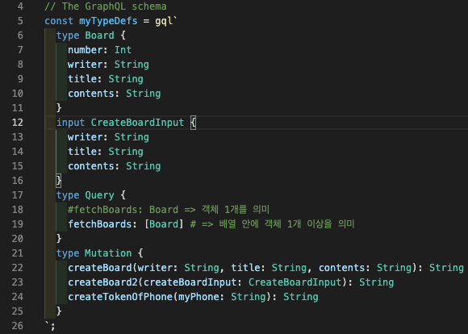

type 정의시, 2가지 종류로 정의할 수 있는데,

-   type - 백엔드 → 프론트엔드로 보내주는 데이터(리턴 값)
-   input - 프론트엔드 → 백엔드로 보내주는 데이터(입력 값)

resolver를 호출할 때 전달하는 데이터인지, 결과로 받는 데이터인지에 따라 정의를 다르게 해야 한다.
