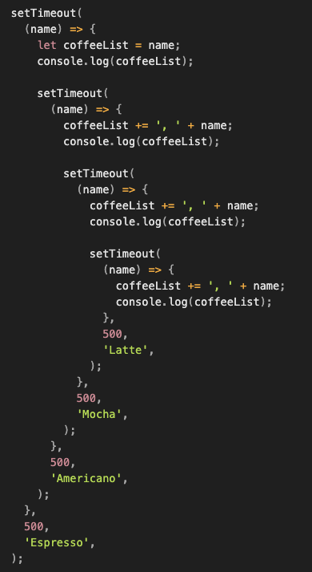

## 6일차 Today-I-Learned



*Callback 지옥*

## Axios

> 💡Axios는 브라우저, Node.js를 위한 HTTP 비동기 통신 라이브러리이다.

-   운영 환경에 따라 브라우저의 XMLHttpRequest 객체 또는 Node.js의 HTTP API 사용
-   Promise(ES6) API 사용
-   Async/Await(ES7) API 사용
-   요청과 응답 데이터의 변형
-   HTTP 요청 취소 및 요청과 응답을 JSON 형태로 자동 변경

> Axios 설치

```shell
node install axios

또는

yarn add axios
```

> Axios 응답 제어

#### .then

비동기 통신이 성공했을 경우, .then()은 콜백을 인자로 받아 결과값을 처리할 수 있다.

#### .catch

.catch()를 통해 오류를 처리한다. error 객체에서는 오류에 대한 주요 정보를 확인할 수 있다.

```javascript
axios.get('/hello')
	.catch(function (error) {
		if (error.response) {
			console.log(error.response.status);
			console.log(error.response.headers);
		}
	}
```

.catch에서 받아오는 error 객체를 통해 error.reponse.status 응답 상태코드와 error.response.headers 응답 헤더정보를 파악할 수 있다.

> Axios HTTP 요청 메소드 종류

#### axios.get(url\[, config\])

서버에서 데이터를 가져올 때 사용하는 메소드. config 객체에는 헤더(header), 응답 초과시간(timeout), 인자값(params) 등의 요청 값을 넘길 수 있다.

#### axios.post(url\[, data\[, config\]\])

서버에 데이터를 새로 생성할 때 사용하는 메소드. data는 생성할 데이터를 넘긴다.

#### axios.put(url\[, data\[, config\]\])

특정 데이터를 수정할 때 사용하는 메소드. post와 다른 점은 post는 여러번 호출할 경우, 새로운 데이터가 지속적으로 추가된다. 반면, put은 한 번 요청을 하거나 여러 번 지속적으로 요청해도 결과값이 동일하다.

#### axios.delete(url\[, config\])

특정 데이터나 값을 삭제할 때 사용하는 메소드.

## Callback

> 💡다른 함수의 인자로 사용되는 함수 or 이벤트에 의해 호출되는 함수

> 다른 함수의 인자로 이용되는 함수

함수의 인자에는 함수가 들어갈 수 있다.

```javascript
function add (x, y, callback){
	let result = x * y
	callback(result)
}

function result (data) {
	console.log(data, "콜백함수 실행")
}

add(5, 10, result)
```

callback이라는 인자는 함수로, add 함수가 실행될 때 result라는 함수명을 받아 실행된다. 이 때, 위의 result 함수를 callback 함수라고 부른다.

> 이벤트에 의해 호출되는 함수

```html
<button onClick={handleClickFunction}></button>
```

button을 클릭하면 onClick 함수가 실행되고, onClick에서는 다시 handleClickFunction을 실행하게 된다. 함수의 인자로 handleClickFunction이 들어가기 때문에 handleClickFunction을 callback 함수라고 부른다.

> 동기 vs 비동기

동기(synchronous) : 현재 실행 중인 코드가 완료된 후 다음 코드를 실행

비동기(asynchronous) : 현재 실행 중인 코드의 완료 여부와 무관하게 즉시 다음 코드로 넘어가 실행

JavaScript는 기본적으로 동기 방식으로 작동한다.

하지만 비동기 방식으로 처리되도록 사용하는 사례가 있다.

-   이벤트 핸들러(onClick...)
-   타이머(setTimeout...)
-   서버에 요청 및 응답

외부에 API 등을 요청하는 라이브러리들은 비동기 방식으로 작동함

> 비동기적 callback

가장 좋은 예시는 setTimeout이다.

```javascript
function Test () {
	console.log("3초 기다리기")
}

setTimeout(Test,3000);
console.log('이건 바로 실행')
```

아래와 같이 순서대로 결과가 나오지 않는데, 이는 비동기적으로 코드가 실행됐기 때문이다.

```javascript
"이건 바로 실행"
"3초 기다리기"
```

## Promise

> callback 지옥

콜백 지옥(callback hell)은 콜백 함수를 익명 함수로 전달하는 과정이 반복되어 코드의 들여쓰기 수준이 감당하기 힘들 정도로 깊어지는 현상을 얘기한다. 주로 이벤트 처리나 서버 통신과 같은 비동기 작업을 수행하기 위해 이런 형태가 자주 등장하는데, 가독성이 떨어지면서 코드를 수정하기 어렵다.

```javascript
setTimeout(
  (name) => {
    let coffeeList = name;
    console.log(coffeeList);

    setTimeout(
      (name) => {
        coffeeList += ', ' + name;
        console.log(coffeeList);

        setTimeout(
          (name) => {
            coffeeList += ', ' + name;
            console.log(coffeeList);

            setTimeout(
              (name) => {
                coffeeList += ', ' + name;
                console.log(coffeeList);
              },
              500,
              'Latte',
            );
          },
          500,
          'Mocha',
        );
      },
      500,
      'Americano',
    );
  },
  500,
  'Espresso',
);
```

이를 해결하기 위해 Promise가 추가되었다.

```javascript
var url = 'https://koreanjson.com/posts/1';

function getData(){
    return new Promise(function(resolve, reject){
      axios.get(url).then(function(response){
        if (response) {
            resolve(response.data);
          }
          reject(new Error("Request is failed"));
        });
      });
    }

let result = [];
getData().then(function(data) {
    for(let v of Object.values(data)){
        result.push(v);
    }
    console.log(result);
    }).catch(function(err) {
    console.error(err);
});
```

axios는 기본적으로 Promise를 지원하는 라이브러리이다.

Promise 안의 콜백 함수는 바로 실행되지만, resolve 또는 reject 함수 호출 구문이 있을 경우 둘 중 하나가 실행되기 전까지는 then 또는 catch로 넘어가지 않는다. 따라서 비동기 작업이 완료될 때 resolve 또는 reject를 호출하는 방법으로 비동기 작업의 동기적 표현이 가능하다.

## Async / Await

비동기 방식을 동기 방식으로 사용하기 위해서는 async / await 를 사용해야 한다.

```javascript
async function getData(url){
  let data = (await axios.get(url)).data;
	return data;
  }

let url = 'https://koreanjson.com/posts/1';

async function dataArr(){
    let data = await getData(url);
    let result = [];
    for(let v of Object.values(data)){
        result.push(v);
    }
    console.log(result);
}

dataArr();
```

비동기 작업을 수행하고자 하는 함수 앞에 async를 표기, 함수 내부에서 실질적인 비동기 작업이 필요한 위치마다 await를 표기한다. 그러면 뒤의 내용을 Promise로 자동 전환하고 해당 내용이 resolve된 이후에 다음으로 진행된다.
