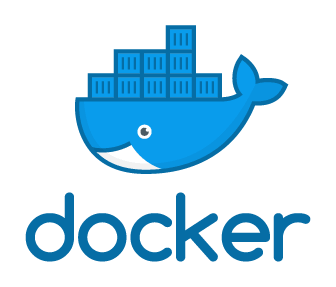
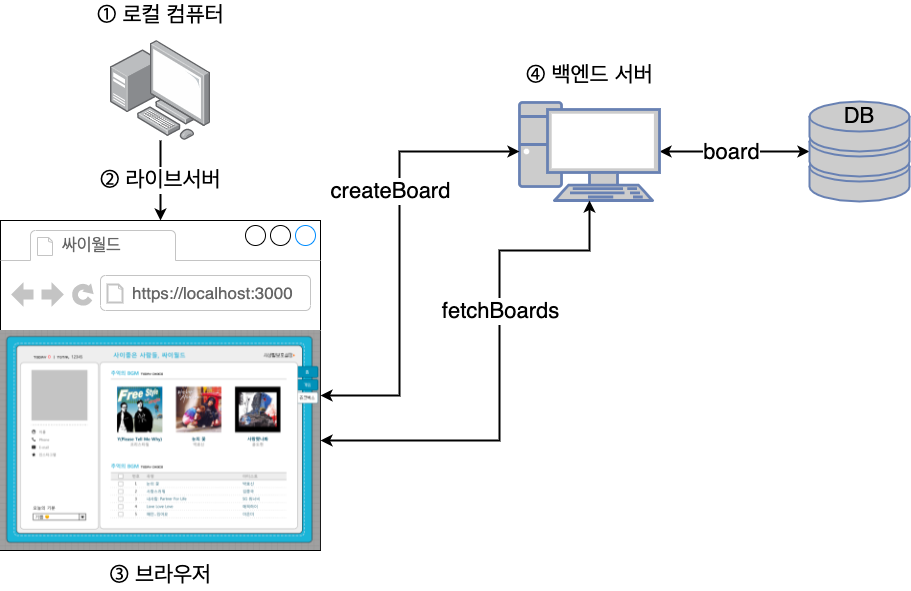
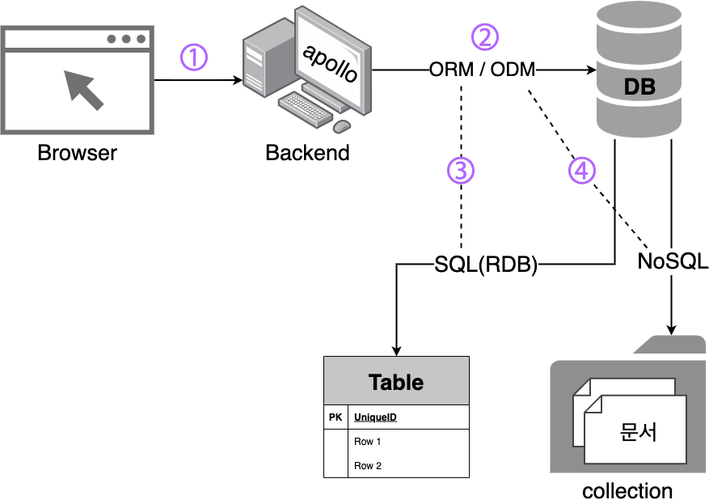
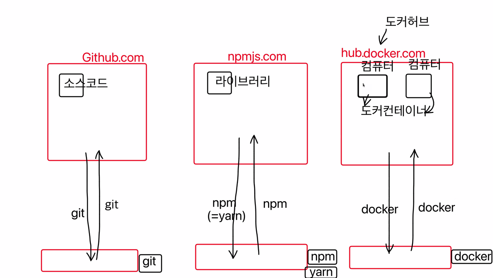
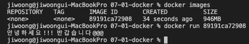
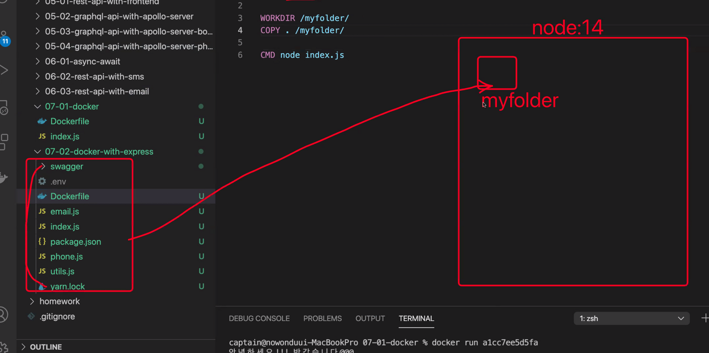
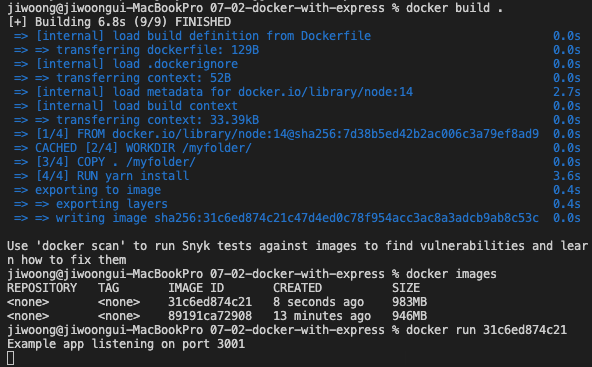
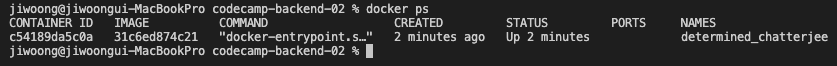
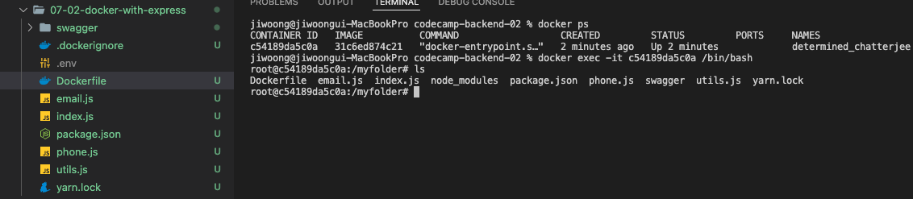
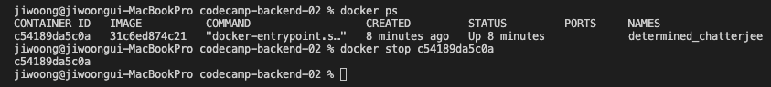

## 7일차 Today-I-Learned



*Docker*

## 프론트엔드와 백엔드의 구조



*Frontend & Backend*

## 데이터베이스 SQL vs NoSQL



*SQL vs NoSQL*

백엔드가 DB로 데이터를 저장하거나, 가져오는 등의 행동을 하기 위해 ORM(Object-Relational Mapper) 혹은 ODM(Object-Document Mapper)라는 자바스크립트 라이브러리를 사용한다.

ORM : 테이블로 이루어진 데이터베이스를 다룰 때 사용하는 SQL을 다른 언어에서 쉽게 사용하도록 해준다.

ODM : document와 collection으로 이루어진 NoSQL을 다룰 수 있도록 해준다.

\- SQL DB : 서로 다른 테이블들 간에 관계를 표현할 수 있어 RDB(Relational Data Base)라고도 불린다.

(MSSQL, Oracle, MySQL, PostgreSQL...)

\- NoSQL DB : Not only SQL로, SQL만을 사용하지 않는 데이터베이스 관리 시스템(여러 유형의 데이터베이스를 사용한다는 것이다)

(MongoDB, Redis, Firebase...)

MySQL : sequalize typeorm와 같은 ORM 사용

MongoDB : mongoose와 같은 ODM 사용

## Docker를 사용하는 이유

새로운 컴퓨터에 개발환경을 구성할 때, 언어, 데이터베이스, node\_modules 등의 버전을 맞춰서 설치해주어야 한다. 예전에는 환경 구축 과정을 하나씩 캡쳐하고 기록해서 정리해두었지만, 매번 구축하는 것은 어려운 일이다. 이를 간편하게 해주는 것이 바로 도커이다.

## Docker란?

> 💡운영체제의 핵심 기능(커널)은 공유하는 가상머신

도커는 개발환경 요소들이 설치된 모습을 이미지로 저장한다. 저장한 이미지를 클라우드에 올린다. 이미지들이 서로 연결되어 동작하는 설정을 문서(Dockerfile)로 저장한다. 새 컴퓨터에서 복사한 문서의 내용대로 이미지를 다운받아 설치한다.

1.  개발/배포환경 통일
2.  프로그램 미리 설치
3.  가벼운 가상컴퓨터



*Docker*

터미널에 docker search node, docker search mongodb 등의 명령어로 검색할 수 있다.

```shell
FROM node:14

WORKDIR /my_folder/ - 명령어 실행할 디렉토리를 설정함
COPY ./index.js /my_folder/ - 호스트 컴퓨터의 현재 디렉토리의 index.js를
                              docker의 /my_folder/로 복사함

RUN node index.js - 여러번 입력 가능함

CMD node index.js - 1번만 입력 가능함(보통 마지막에 실행하는 명령어를 CMD로 함)
```

Dockerfile에 위와 같이 작성 후 저장하고 아래 명령어를 터미널에서 실행한다.

```shell
docker build . # 도커 이미지를 빌드함

docker images # 빌드한 이미지를 확인 가능함

docker run 89191ca72908 # 해당 이미지 ID로 이미지를 실행한 다음 docker 종료됨
```



*Docker를 빌드하고 실행*

## .dockerignore



docker에서 소스를 실행하기 위해서는 node\_modules 디렉토리가 필요한데,

생각나는 방법은 아래 2가지가 있다.

1.  밖에서 생성 후 docker에 복사해주는 방법
2.  docker 안에서 yarn install해주는 방법

1번 방법은 각자의 호스트 컴퓨터마다 개발환경의 버전이 다 다르기 때문에 문제가 된다.

2번 방법으로 해야 모두 같은 버전으로 실행이 가능하다.

그렇기 때문에 호스트에서 node\_modules가 있더라도 docker에 복사하면 안된다.

따라서, .dockerignore 파일을 생성 후, 아래와 같이 작성하고 저장하면 docker 빌드시 아래 폴더를 무시한다.

```shell
node_modules/
```

Dockerfile에 아래와 같이 입력 후 빌드하고 실행한다.

```shell
FROM node:14

WORKDIR /myfolder/
COPY . /myfolder/

RUN yarn install

CMD node index.js
```



*Docker 빌드 및 실행*

별도의 터미널을 켜서 docker ps를 입력하면 실행중인 docker를 확인할 수 있다.



*실행중인 docker 컨테이너*



*실행중인 docker 컨테이너에 접속*

docker ps 및 docker exec -it {CONTAINER ID} /bin/bash로 실행중인 docker에 접속 가능하다.



별도 터미널에서 docker stop {CONTAINER ID}를 입력하면 해당 docker가 종료되고, 접속중이던 다른 터미널도 접속이 끊긴다.

docker rm {CONTAINER ID} : docker 이미지 실행기록을 삭제할 수 있다.

docker rmi {CONTAINER ID} : docker 이미지 자체를 삭제할 수 있다.(사용하려면 다시 빌드해야 한다)

## 포트포워딩

docker를 빌드하고 실행했지만, 브라우저나 postman을 이용해 접속하려고 하면, 접속이 되지 않는다.

내 컴퓨터 안에 도커라는 프로그램이 있고, 그 안에서 node index.js가 실행 중이기 때문에, 가상 컴퓨터 안에서만 해당 포트로 접속 가능하고, 내 컴퓨터에서는 접속이 불가하다.

따라서, 가상 컴퓨터의 포트와 내 컴퓨터의 포트를 연결해줘야 한다. 이것을 포트포워딩이라고 부른다.

docker run -p 1000:3000 88ef89062a78 : 내 컴퓨터에서 1000번 포트로 접속 시도하면, docker의 3000번 포트로 포트포워딩 해준다.

## Docker와 package.json

```shell
FROM node:16

WORKDIR /my_backend/
COPY . /my_backend/

RUN yarn install
CMD node index.js
```

docker는 이미지를 빌드할 때, 이미 수행했던 작업을 캐싱해놓고, 그 작업은 빠르게 넘어간다.

하지만, 위의 기존 설정을 보면, 소스가 하나라도 수정되면 매번 node\_modules를 다시 설치하고 있다.

따라서, package.json 파일과 yarn.lock 파일을 먼저 복사해 node\_modules를 설치하도록 수정하면, 변경사항이 없다면 생략하도록 구성할 수 있다.

```shell
FROM node:16

WORKDIR /my_backend/
COPY ./package.json /my_backend/
COPY ./yarn.lock /my_backend/
RUN yarn install

COPY . /my_backend/
CMD node index.js
```

## Docker 관련 명령어

```shell
docker build . # 도커 이미지를 빌드함

docker images # 빌드한 이미지를 확인 가능함

docker run {IMAGE_ID} # 해당 이미지 ID로 이미지를 실행한 다음 docker 종료됨

docker ps # 실행중인 docker 컨테이너 확인

docker ps -a #실행중, 이전 실행한(종료된) docker 컨테이너 확인

docker ps -q # 실행중인 docker 컨테이너 ID 목록

docker ps -a -q # 실행중, 이전 실행한 docker 컨테이너 ID 목록

docker exec -it {CONTAINER_ID} /bin/bash # 실행중인 docker에 접속

docker stop {CONTAINER_ID} # 해당 docker가 종료되고, 접속중이던 다른 터미널도 접속이 끊김

docker stop `docker ps -q` # 실행중인 전체 docker 컨테이너 중지

docker rm {CONTAINER_ID} # 종료된 docker 컨테이너 실행기록을 삭제

docker rm `docker ps -a -q` # 실행중, 이전 실행한(종료된) docker 컨테이너 기록 삭제

docker rmi {CONTAINER_ID} # docker 이미지 자체를 삭제(사용하려면 다시 빌드해야 함)

docker rmi `docker images -q` # 전체 docker 이미지들 삭제

docker run -p 1000:3000 {CONTAINER_ID} # 내 컴퓨터에서 1000번 포트로 접속 시도하면, docker의 3000번 포트로 포트포워딩
```
