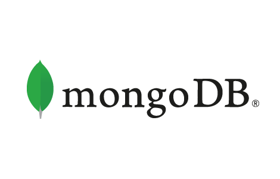
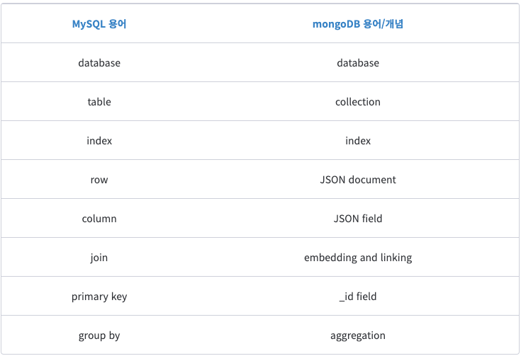
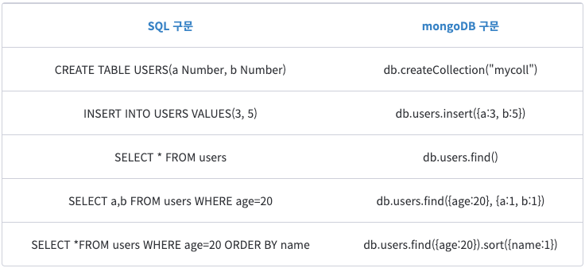
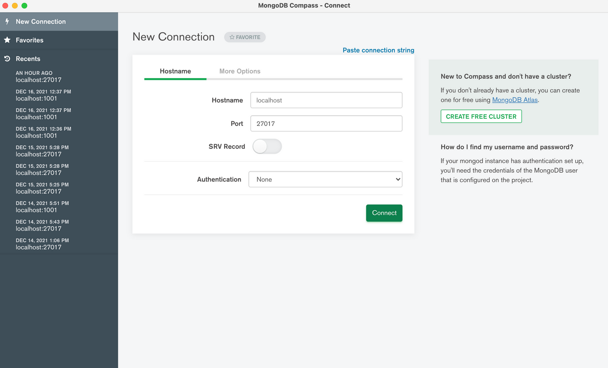
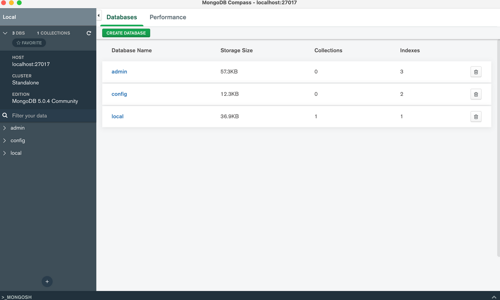
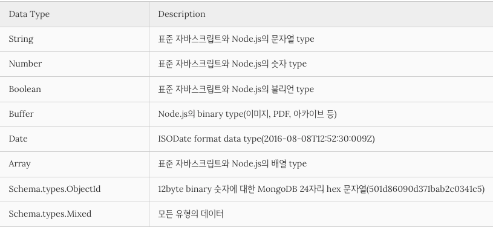

## 8일차 Today-I-Learned



*mongoDB*

## MongoDB

> 💡 문서지향(Document-Oriented) 저장소를 제공하는 NoSQL 데이터베이스 시스템

> MongoDB 특징

mongoDB에서는 데이터가 Document로 불리며, 이 데이터의 집합을 Collection(RDMS에서는 Table)이라고 한다. 스키마 제약 없이 자유롭고, **BSON(Binary JSON) 형태로** 각 문서가 저장되며 배열(Array)이나 날짜(Date) 등 기존 **RDMS에서 지원하지 않던 형태로도 저장**할 수 있기 때문에 **관계를 연결하는 JOIN이 필요 없이 한 문서에 좀 더 이해하기 쉬운 형태 그대로 정보를 저장**할 수 있다는 것이 특징이다.

문서지향 데이터베이스로, **객체지향 프로그래밍과 잘 맞고 JSON을 사용할 때 아주 유용하다.** 따라서 자바스크립트를 기반으로 하는 Node.js와 호환이 매우 좋기 때문에, Node.js에서 가장 많이 사용되는 데이터베이스이다. 물론 mysql 같은 관계형 데이터베이스 사용도 가능하다.

MongoDB의 특징은 아래와 같다.

-   Join이 없으므로 Join이 필요 없도록 데이터 구조화가 필요
-   다양한 종류의 쿼리문을 지원(필터링, 수집, 정렬, 정규표현식 등)
-   관리의 편의성
-   스키마 없는(Schemaless) 데이터베이스를 이용한 신속 개발. 필드를 추가하거나 제거하는 것이 매우 쉬워짐
-   쉬운 수평 확장성
-   인덱싱 제공

> SQL vs MongoDB





> MongoDB 설치

Window 혹은 Mac 환경에 따라 MongoDB 설치

```shell
brew services #

brew services start mongodb-community # mongoDB 실행

brew services stop mongodb-community # mongoDB 중지
```

설치하고 위의 명령어를 통해 터미널에서 실행 및 중지가 가능하다.

> MongoDB Compass

MongoDB용 GUI 데이터를 시각적으로 탐색하는 툴로, DB를 쉽게 조회하고 수정할 수 있다.

PC에 MongoDB를 설치하여 실행중이라면, 아래와 같이 localhost:27017로 접속이 가능하다.





## Docker-compose

> 💡 복수 개의 컨테이너를 실행시키는 도커 애플리케이션이 정의를 하기 위한 툴

기본적으로 yaml 파일을 이용해 애플리케이션의 서비스를 구성할 수 있다. 여러 개의 docker 내부 속성을 설정하고, yaml 파일을 실행시켜 마치 docker를 배치로 한 번에 실행시키는 것과 같다.

> Docker-compose를 활용한 mongoDB 연결

이전에 Dockerfile을 작성한 것처럼, 별도의 Dockerfile.mongo를 만들어 아래와 같이 mongo 버전을 최신으로 정의했다.

```shell
// Dockerfile.mongo

FROM mongo:latest
```

기존의 백엔드와 mongoDB 서버를 한 번에 실행하기 위해서 yaml 파일을 정의해야 한다.

.yml 혹은 .yaml 로 사용 가능하다. docker-compose.yaml 파일을 아래와 같이 작성한다.

```shell
version: "3.7"

services:
  my-backend:
    build:
      context: .
      dockerfile: Dockerfile
    ports:
      - 3001:3001

  my-database:
    build:
      context: .
      dockerfile: Dockerfile.mongo
    ports:
      - 27017:27017
```

service 정의는 각각의 컨테이너에 적용되는 configuration을 포함하고 있다.

service 내부에 my\_backend와 my\_database를 정의했다.

-   context: Dockerfile을 포함하는 디렉토리 경로 또는 git repo의 url이다.
-   dockerfile: Dockerfile을 대체하는 파일을 지정해준다.(DB서버의 경우 Dockerfile.mongo로 정의했으므로)

ports는 호스트OS와 컨테이너의 포트를 바인딩 시켜준다.

```shell
docker-compose build
```

docker-compose.yaml 파일을 실행시켜 image를 build한다.

```shell
docker-compose up
```

그리고 컨테이너를 실행시켜 준다.

yaml파일에 정의한 port정보대로 요청하거나 DB접속을 하면, 정상적으로 연결되는 것을 확인할 수 있다.

Docker-compose에 설정된 docker끼리는 포트포워딩이 없어도 서로 연결이 된다.(ports 정보를 지워도 서로 연결된다)

> Dockerfile.mongo를 image로 변경

```shell
version: "3.7"

services:
  my-backend:
    build:
      context: .
      dockerfile: Dockerfile
    volumes:
      - ./index.js:/myfolder/index.js
      - ./email.js:/myfolder/email.js
      - ./phone.js:/myfolder/phone.js
      - ./utils.js:/myfolder/utils.js
    ports:
      - 3001:3001

  my-database:
    image: mongo:latest
    ports:
      - 27017:27017
```

Dockerfile.mongo에 정의했던 FROM mongo:latest 정보를 image로 변경할 수 있다.

Dockerfile.mongo는 삭제하고, 위와 같이 image: mongo:latest를 yaml 파일에 정의한다.

그리고 build를 하면, my-database는 image를 사용하기에 build가 생략된다.

동일하게 postman과 mongoDB Compass로 접속하면 정상적으로 접속되는 것을 확인할 수 있다.

## ODB(Object Document Mapping) & Mongoose

Mongoose는 Node.js와 MongoDB를 위한 ODM(Object Data Mapping) Library이다.

호환성이 없는 Javascript와 MongoDB의 데이터를 Mapping하여 간편한 CRUD를 가능하게 한다.

Mongoose를 사용하기 위해 명령어로 설치한다.

```shell
npm install mongoose

혹은

yarn add mongoose
```

> Defining a Model

```javascript
// board.model.js

import mongoose from 'mongoose'

const boardSchema = new mongoose.Schema({
    writer: String,
    title: String,
    contents: String,
});

export const Board = mongoose.model('Board', boardSchema)
```

Model을 정의하기 위해서는, mongoose 라이브러리를 import한다.

새로운 스키마를 boardSchema에 담고, model() 메소드를 이용해 문자열과 schema를 전달하여 model을 생성한다.

그리고 외부에서 접근할 수 있도록 export 해준다.

아래는 mongoose schema에서 지원하는 Data type이다.



> Connecting to MongoDB

javascript에서 mongoDB에 연결하려면 아래와 같이 작성한다.

```javascript
//index.js

mongoose.connect("mongodb://my_database:27017/codecamp");
```

my\_database는 docker-compose.yaml에서 정의했던 서비스명으로, 위와 같이 적으면 my\_backend에서 접근이 가능하다. 호스트OS에선 당연히 안된다.

만약 추가 연결을 생성하려면 mongoose.createConnection을 사용한다.

> POST

```javascript
//index.js

app.post('/board', async function (req, res) {
    // 데이터 등록하는 로직(데이터베이스에 저장하기)

    const board = new Board({writer: req.body.writer, title: req.body.title, contents: req.body.contents})
    await board.save()

    res.send("등록에 성공하였습니다.")
})
```

/board endpoint를 지정해서 POST 요청을 받았을 때 JSON 데이터를 담은 BODY에서 각각의 요소를 mongoDB의 boards collection에 저장해준다.

> GET

```javascript
//index.js

app.get('/boards', async function (req, res) {
    // 데이터 조회하는 로직(데이터베이스에서 꺼내오기)

    const boards = await Board.find()
    res.send(boards);
})
```

/board endpoint를 지정해서 GET 요청을 받으면, mongoDB의 boards collection에 저장된 모든 데이터를 조회해서 응답해준다.

find는 보통 모든 데이터를 조회할 때 사용되며, findOne은 특정 데이터만 조회할 때 자주 사용한다.

## Docker에 Nodemon 적용

소스가 변경될 경우, nodemon은 서버를 자동으로 재시작해준다.

하지만, docker에서 nodemon을 설치했음에도 불구하고, 내컴퓨터의 소스가 변경되어도 docker의 소스는 그대로이기 때문에 자동으로 재시작 되지 않는다. 그래서 내컴퓨터의 소스를 변경했을 때, docker의 소스에 적용되도록 설정이 필요하다.

이 때 필요한 것이 volumes 이다.

```shell
version: "3.7"

services:
  my-backend:
    build:
      context: .
      dockerfile: Dockerfile
    volumes:
      - ./index.js:/myfolder/index.js
      - ./email.js:/myfolder/email.js
      - ./phone.js:/myfolder/phone.js
      - ./utils.js:/myfolder/utils.js
    ports:
      - 3001:3001

  my-database:
    image: mongo:latest
    ports:
      - 27017:27017
```

docker-compose.yaml 파일에 volumes를 추가하고, 자동 적용될 파일을 정의하면 된다.

그러면 호스트OS에서 해당 파일이 변경 및 저장되면 docker에 자동 적용되어 nodemon이 서버를 자동 재실행한다.
