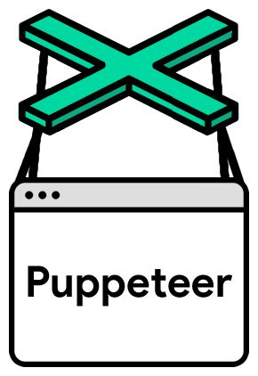
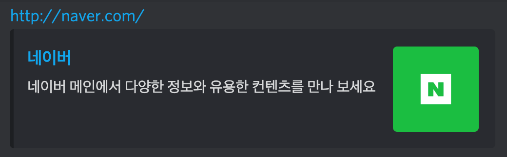
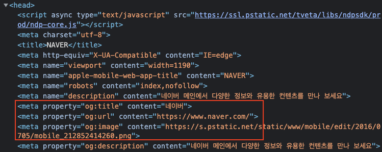
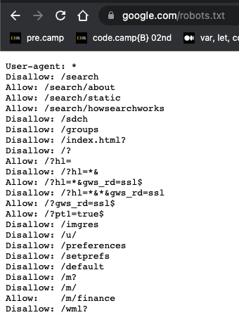

## 9일차 Today-I-Learned



*Puppeteer*

## 스크래핑 vs 크롤링

> 스크래핑

> 💡 특정한 웹사이트에서 사이트의 html, 데이터를 긁어오는 것



*Open Graph 태그를 이용한 예시*

유저가 사이트에서 게시글을 작성하고 등록할 때, Backend API로 글의 내용을 보내주게 된다. 이 때, 글의 내용에 http가 포함된 URL이 있다면, 그 사이트에 접속해서 Open Graph가 있는 내용을 긁어와서 저장한다. 나중에 글의 상세보기를 할 때, 위의 이미지처럼 사이트 소개를 같이 보여주게 된다.

> 크롤링

> 💡 여러 웹페이지를 돌아다니며 탐색하는 일  
> 보통 크롤링을 하는 과정에서 방문한 사이트의 데이터를 스크래핑하는 경우가 있어 구분없이 부르는 경우가 있다.

## 오픈 그래프 스크래핑 with cheerio

> Open Graph protocol?

> 💡 페이스북에서 시작한 것으로, 아래의 정보들을 html의 head 태그 안에 meta 태그로 넣어주는 것

-   og:title - The title of your object as it should appear within the graph, e.g., "The Rock".
-   og:type - The [type](https://ogp.me/#types) of your object, e.g., "video.movie". Depending on the type you specify, other properties may also be required.
-   og:image - An image URL which should represent your object within the graph.
-   og:url - The canonical URL of your object that will be used as its permanent ID in the graph, e.g., "[https://www.imdb.com/title/tt0117500/](https://www.imdb.com/title/tt0117500/)"

> cheerio

> 💡 Javascript에서 웹사이트 스크래핑을 가능하게 해주는 라이브러리

javascript에서 사용하려면 아래처럼 터미널에 입력하여 설치한다.

```shell
npm install cheerio

혹은

yarn add cheerio
```

```javascript
import axios from "axios";
import cheerio from "cheerio";

async function getOpenGraph(myData) {
  const targetURL = myData.contents
    .split(" ")
    .filter((el) => el.startsWith("http"))[0];

  const aaa = await axios.get(targetURL);
  const $ = cheerio.load(aaa.data);
  $("meta").each((_, el) => {
    if ($(el).attr("property")) {
      const key = $(el).attr("property").split(":")[1];
      const value = $(el).attr("content");
      console.log(key, value);
    }
  });
}

const frontendData = {
  title: "안녕하세요",
  contents: "여기 정말 좋은 것 같아요! https://daum.net",
};

getOpenGraph(frontendData);
```

스크래핑을 위한 cheerio 라이브러리, 그리고 웹사이트에 요청을 위한 axios 라이브러리를 설치하고 import한다.

frontendData라는 객체를 선언하고, contents 안에 URL을 추출해 접속하려고 한다.

URL을 추출해 axios를 통해 접속하고, 받아온 html 데이터를 cheerio에 넘겨준다.

cheerio의 결과는 보통 $이라는 변수명을 이용한다.



*웹사이트의 meta 태그 내 open graph*

$에서 property라는 attribute를 가지는 “meta” 태그를 찾아 각각 property와 content의 값을 가져오도록 코드를 구현했다.

cheerio의 attr, each 함수를 통해 구현했으므로 해당 함수에 대해 숙지하도록 하자.

## 크롤링 with puppeteer

JS에서 크롤링을 사용하기 위해서, puppeteer라는 라이브러리를 사용한다.

```shell
npm install puppeteer

혹은

yarn add puppeteer
```

```javascript
import puppeteer from "puppeteer";

async function startCrawling() {
  const browser = await puppeteer.launch({ headless: false });
  const page = await browser.newPage();
  await page.setViewport({ width: 1280, height: 720 });
  await page.goto("https://www.goodchoice.kr/product/search/2/2012");
  await page.waitForTimeout(1000);

  const stage = await page.$eval(
    "#poduct_list_area > li:nth-child(2) > a > div > div.name > div > span",
    (el) => el.textContent
  );

  await page.waitForTimeout(1000);

  const location = await page.$eval(
    "#poduct_list_area > li:nth-child(2) > a > div > div.name > p:nth-child(4)",
    (el) => el.textContent
  );

  await page.waitForTimeout(1000);

  const price = await page.$eval(
    "#poduct_list_area > li:nth-child(2) > a > div > div.price > p > b",
    (el) => el.textContent
  );

  await page.waitForTimeout(1000);

  console.log(stage);
  console.log(location);
  console.log(price);

  await browser.close();
}

startCrawling();
```

기본적인 puppeteer 크롤링의 사용법은 위와 같다.

browser라는 변수를 선언해 puppeteer를 실행하고(옵션 설정), 브라우저의 새 페이지를 연 다음, 창 크기 설정 및 사이트 주소를 입력해 사이트에 접속한다.

동기로 작동시키기 위해 await를 사용해주고, 로딩을 기다리기 위해 waitForTimeout을 사용한다.

데이터를 가져오려는 사이트에 방문해 개발자도구를 이용하여 copy > copy selector를 하면 css 선택자 복사가 가능하고, 이를 page.$eval(”~~~”, callback) 구문을 통해 정보를 가져와 변수에 저장할 수 있다.

파일을 실행하면 브라우저가 열리고 접속이 되어 정보를 가져오는 것을 확인할 수 있다.



*robots.txt*

여담으로, 사이트 뒤에 /robots.txt 를 치면 크롤링이 허용되거나 허용되지 않는 부분을 확인할 수 있는데, 무조건적인 기준은 아니다.

## iframe 내의 크롤링

위의 예제는 스크래핑과 같이 웹사이트에 들어가 바로 태그를 긁어왔다. 하지만, 로그인이 필요하다거나, 페이지 이동, 클릭 이벤트가 필요한 사이트의 경우 puppeteer가 유용하다.

```javascript
import puppeteer from "puppeteer";

async function startCrawling() {
  const browser = await puppeteer.launch({ headless: false });
  const page = await browser.newPage();
  await page.setViewport({ width: 1280, height: 720 });
  await page.goto("https://finance.naver.com/item/sise.naver?code=005930");
  await page.waitForTimeout(1000);
  const framePage = await page
    .frames()
    .find((el) => el.url().includes("/item/sise_day.naver?code=005930"));

  for (let i = 3; i <= 7; i++) {
    await page.waitForTimeout(500);

    const date = await framePage.$eval(
      `body > table.type2 > tbody > tr:nth-child(${i}) > td:nth-child(1) > span`,
      (el) => el.textContent
    );

    const price = await framePage.$eval(
      `body > table.type2 > tbody > tr:nth-child(${i}) > td:nth-child(2) > span`,
      (el) => el.textContent
    );

    console.log(`날짜: ${date}, 가격: ${price}`);
  }

  await browser.close();
}

startCrawling();
```

위의 코드에서는 framePage라는 변수를 선언하여, 페이지 안에 iframe 태그로 또다른 페이지가 있을 경우 그 html을 읽어올 수 있도록 한다.
