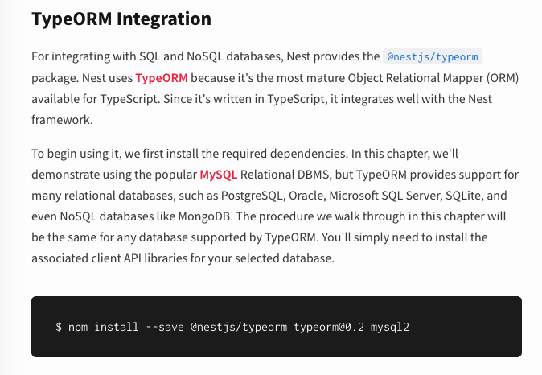
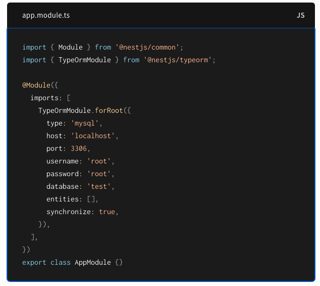
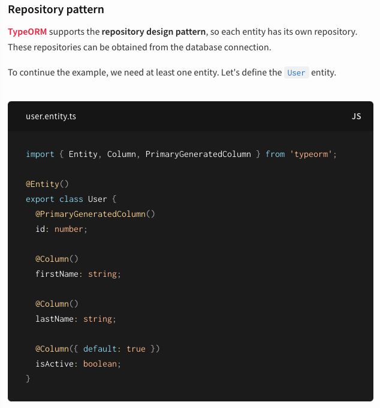
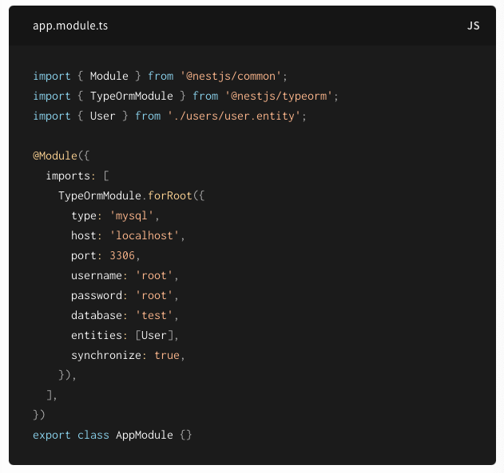
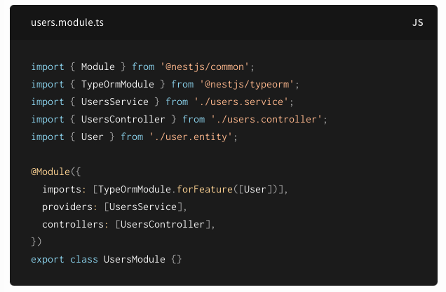
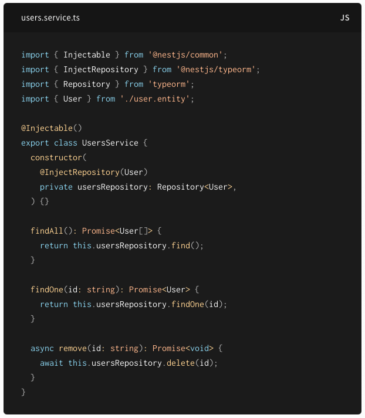

*TypeORM*

## TypeORM

TypeORM은 백엔드 서버에서 SQL을 직접 작성하지 않고, DB와의 통신을 가능하게 해주는 라이브러리이다. NodeJS 뿐만 아니라 Browser, Cordova, React Native 등의 환경에서도 TypeScript와 JavaScript를 사용해 사용이 가능하다.

ORM(Object-Relational Mapping)은 객체지향 프로그래밍, 그리고 관계형 데이터베이스 간에 호환되지 않는 데이터를 연결시켜주는 도구다. 코드로 객체를 만들면, 대응하는 SQL을 자동생성하여 SQL에 데이터를 생성해주는 것이다.

지금 배우고 있는 프레임워크는 NestJS로, TypeScript 기반이다. NestJS의 Docs를 살펴보면 DB와 연결하는 방법으로 TypeORM을 사용할 수 있도록 가이드가 나와있다.

위와 같이 필요한 모듈을 설치해주고, 코드에서도 몇가지 작업이 필요하다.

app.module.ts 파일에서 설치한 TypeOrmModule을 import 해주고, 연결하려는 DB의 정보를 입력하여 연결할 준비를 한다.

다음은 실제로 DB에 생성할 테이블을 Entity로 작성하는 부분이다.

문법만 TypeScript일 뿐, 테이블의 구조와 크게 다르지 않다.

typeorm 모듈을 import 해주고, @Entity와 @PrimaryGeneratedColumn, @Column 등의 데코레이터를 통해 기본키, 컬럼 등을 설정해줄 수 있다.

추가한 User라는 entity를 사용하기 위해서는, app.module.ts에 비워져있던 entities 부분에 User를 넣어주어야 한다.

또한, User를 사용하는 users.module.ts 파일에도 위와 같이 entity를 import하고 추가해야 한다.

그리고 user service 단에서 @InjectRepository(User) 데코레이터를 통해 usersRepository를 주입해줄 수 있다. 그 다음에는 find, findOne 등과 같은 실제 SQL문과 같은 기능을 하는 함수를 사용하여 기능을 구현할 수 있다.

간단하게 NestJS에서 TypeORM을 사용하는 예제를 Docs를 통해 살펴보았다.

백엔드 개발을 하면서, DB 관리자 없이 DB 설계나 SQL 작성을 직접 해야하는 경우가 있을 수 있다.

SQL에 능숙하면 좋겠지만, 익숙하지 않더라도 위와 같이 TypeORM을 통해 객체지향 프로그래밍 코드를 데이터베이스 데이터로 쉽게 변환하여 사용이 가능하다.

\[출처\]

[https://typeorm.io/](https://typeorm.io/)

[https://docs.nestjs.com/techniques/database](https://docs.nestjs.com/techniques/database)

[https://yuni-q.github.io/backend/typeorm-톺아보기/](https://yuni-q.github.io/backend/typeorm-톺아보기/)

[https://sangjuntech.tistory.com/6](https://sangjuntech.tistory.com/6)
